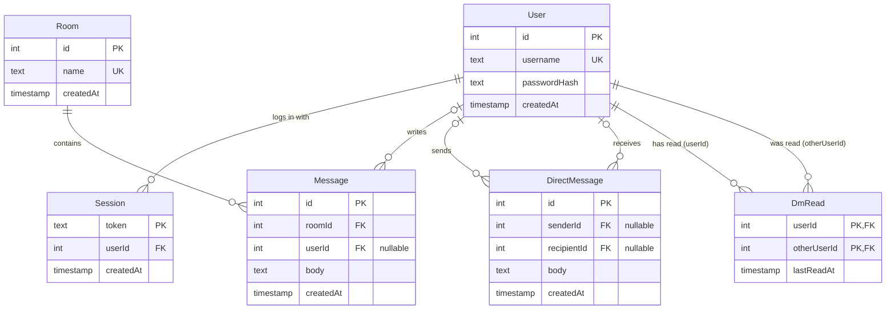

# ER diagram and data model

GitHub draws the diagram below from the Mermaid code. PK = primary key, FK = foreign key, UK = unique.

## Entities

| Entity | What one row is | Primary key | Foreign keys |
|---|---|---|---|
| User | an account | `id` (serial) | none |
| Session | one logged-in terminal | `token` (random uuid) | `userId` → User |
| Room | a chat room (`general` always exists) | `id` (serial) | none |
| Message | a message posted in a room | `id` (serial) | `roomId` → Room, `userId` → User (nullable) |
| DirectMessage | a private message between two users | `id` (serial) | `senderId` → User, `recipientId` → User (both nullable) |
| DmRead | when a user last read their chat with another user | (`userId`, `otherUserId`) | both → User |

## Relationships

| Relationship | Type | How it is stored | On delete |
|---|---|---|---|
| User → Session | one-to-many | `Session.userId` | CASCADE: deleting a user logs out all their terminals |
| Room → Message | one-to-many | `Message.roomId` | CASCADE: deleting a room deletes its messages |
| User → Message | one-to-many (optional) | `Message.userId` | SET NULL: the message stays, shown as "deleted user" |
| User ↔ Room | many-to-many | through `Message` (a user posts in many rooms, a room has many posters) | |
| User ↔ User (DMs) | many-to-many, self-referencing | through `DirectMessage` (`senderId`, `recipientId`) | SET NULL: the other person keeps the conversation |
| User ↔ User (read markers) | many-to-many, self-referencing | through `DmRead`; the pair is the primary key, so one marker per pair | CASCADE: markers of a deleted user are useless |

**One-to-one:** not used. Everything we know about a user (name, password hash, join date) is a single value, so it lives in `User`. A one-to-one table (for example a separate `Profile`) would only add a join.

## Why these choices

- **Surrogate integer ids** for `User`, `Room` and messages, not usernames. Integers are small in indexes and foreign keys, and a username could be renamed later without touching any message.
- **`Session.token` is the primary key** because the server looks a session up by token on every request and every socket connection. It is a random uuid, so it cannot be guessed.
- **`DirectMessage` is separate from `Message`.** A room message has a room, a DM has a recipient. One shared table would need a nullable `roomId` and a nullable `recipientId` with a rule that exactly one is set. Two tables are simpler and each gets its own index.
- **Unread counts are not stored.** They are computed from `DirectMessage.createdAt > DmRead.lastReadAt` (see query Q8). Storing a counter would be a second copy of the same fact that can drift out of sync.
